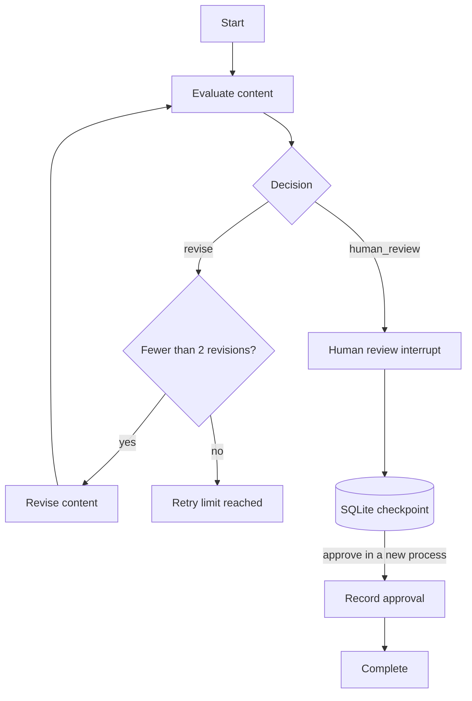

# Task 4 — Resumable Review Workflow

A local, deterministic content-review workflow built with **Python 3.13, LangGraph, Pydantic v2, and SQLite**. It evaluates content, performs at most two revisions, pauses for human approval, and resumes after the CLI process exits—without repeating completed work or duplicating completion events.

The implementation intentionally uses fake evaluation and revision adapters. **No external model API, credentials, or network access is required.**

## Quick start

From `src/task-4_arif/`:

```
uv sync
uv run pytest -v
```

The commands below use the default local persistence directory, `.workflow_data/`. Use a unique workflow ID for each new example, or specify `--data-dir` to isolate demonstrations.

```
# Start: evaluate, revise once, then pause for approval.
uv run python -m workflow.cli start demo-001 \
  --content-id article-001 \
  --title "Example article" \
  --body "Initial content." \
  --decisions revise human_review

# These are separate CLI invocations (and therefore separate processes).
uv run python -m workflow.cli status demo-001
uv run python -m workflow.cli approve demo-001
uv run python -m workflow.cli events demo-001

# Repeating approval is safe and does not create another completion event.
uv run python -m workflow.cli approve demo-001
```

`start`, `status`, and `approve` print the workflow state as JSON; `events` prints a JSON array of audit events. Errors are written to standard error with a nonzero exit code.

To choose a different persistence directory, put the global flag **before** the subcommand:

```
uv run python -m workflow.cli --data-dir /tmp/review-demo status demo-001
```

Use the same `--data-dir` for all commands belonging to a workflow.

## Workflow behavior

````

````

The fake evaluator follows the `--decisions` sequence. The fake reviser deterministically appends a revision marker to the content body. The revision policy permits **at most two revisions**, not two evaluations: a third `revise` decision produces the terminal `retry_limit_reached` outcome rather than a third revision.

### Example scenarios

**Immediate review:** omit `--decisions` (the default is `human_review`), or pass `--decisions human_review`. The workflow evaluates once and pauses for approval.

**One revision:** pass `--decisions revise human_review`. The workflow revises once, evaluates twice, and pauses for approval.

**Retry limit:** pass `--decisions revise revise revise`. The workflow evaluates three times, revises twice, and terminates with `retry_limit_reached`. This terminal workflow cannot be approved.

The state includes `workflow_id`, `content`, `evaluation`, `evaluation_count`, `revision_count`, and `status`. Relevant statuses include `awaiting_review`, `completed`, and `retry_limit_reached`. The application service derives `awaiting_review` from the persisted LangGraph checkpoint rather than having the CLI guess the status.

## Resuming after a restart

Each workflow uses its `workflow_id` as LangGraph's persistent `thread_id`. The graph is compiled with a SQLite checkpointer, so a new CLI invocation can read the existing checkpoint and resume the interrupted human-review node using `Command(resume={"approved": True})`.

To verify restart behavior:

1. Run `start` and confirm that the state reports `awaiting_review`.
2. Exit the CLI process (each command already exits after completing).
3. Run `status` with the same workflow ID and data directory.
4. Run `approve` from a new process; confirm `completed`.
5. Run `approve` again and inspect `events`; there should be only one approval and one completion event.

The checkpoint stores **execution state**, while the separate SQLite event log stores an **inspectable audit history**. They are intentionally separate concerns.

## CLI reference

|Command|Purpose|
|---|---|
|`start WORKFLOW_ID --content-id ID --title TITLE --body BODY [--decisions ...]`|Start a workflow, or safely return an existing workflow for an identical original content request.|
|`status WORKFLOW_ID`|Read persisted workflow state.|
|`approve WORKFLOW_ID`|Resume an interrupted human-review workflow; return the existing state if already completed.|
|`events WORKFLOW_ID`|List ordered audit events.|

Global option: `--data-dir PATH` (default `.workflow_data/`). Run `uv run python -m workflow.cli --help` for full argument help.

## Architecture

The implementation follows **Ports & Adapters** with selective domain-driven design (DDD):

|Layer|Responsibility|Main modules|
|---|---|---|
|Domain models and policy|Validate content and evaluations; enforce the revision limit.|`workflow/models/`, `workflow/policies/`|
|Ports|Define evaluator, reviser, and event-log contracts.|`workflow/ports/`|
|Adapters|Provide deterministic evaluation/revision and SQLite audit logging.|`workflow/adapters/`|
|Orchestration|Coordinate evaluation, revision, review interrupt, completion, and retry-limit routing.|`workflow/graph.py`, `workflow/nodes/`|
|Persistence|Persist LangGraph checkpoints to SQLite.|`workflow/persistence/checkpoint.py`|
|Application service|Expose start, status, approve, and events; enforce operation-level rules.|`workflow/services/workflow_service.py`|
|Interface|Parse CLI arguments and serialize JSON results.|`workflow/cli.py`|

The domain policy determines **what is allowed**; LangGraph determines **which step executes next**. The CLI delegates workflow rules to `WorkflowService`.

### Audit events

The SQLite event log records meaningful transitions, including:

- `workflow_started`
- `content_evaluated`
- `content_revised`
- `human_review_requested`
- `approval_recorded`
- `retry_limit_reached`
- `workflow_completed`

Event identifiers are deterministic, and the event-log adapter handles duplicate appends idempotently. This is particularly important around LangGraph interrupts, where a node can execute again when resumed.

## Idempotency and validation

- **Duplicate start:** an existing workflow ID is accepted only when the supplied `ContentItem` matches the **original submission** saved in its `workflow_started` event. The comparison includes content ID, title, body, and metadata. It deliberately does **not** compare against the potentially revised content in the latest checkpoint.
- **Conflicting start:** reusing an existing workflow ID with different original content raises a conflict.
- **Duplicate approval:** approving an already-completed workflow returns its persisted state without running the graph or appending another completion event.
- **Invalid transitions:** unknown workflows and attempts to approve a retry-limit workflow are rejected.
- **Input validation:** Pydantic models validate content and evaluation data; the CLI reports validation and application errors.

## Testing

```
# Entire suite
uv run pytest -v

# Application service and CLI behavior
uv run pytest tests/test_workflow_service.py tests/test_cli.py -v

# Real persistence across separate Python processes
uv run pytest tests/test_cli_subprocess.py -v
```

The latest verified local run reported **138 passing tests**. Coverage includes model validation, deterministic routing, revision limits, review interrupts, durable resume, audit event ordering, duplicate starts, duplicate approvals, CLI errors, and independent-process execution.

## Persistence and operational notes

The CLI creates two SQLite files inside the selected data directory:

- `checkpoints.db` — LangGraph execution checkpoints.
- `events.db` — ordered workflow audit events.

The default `.workflow_data/` directory contains local runtime data and should not be committed. Keep the two databases together when moving a persisted workflow to another location. A workflow ID is scoped to the chosen data directory.

## Design trade-offs and limitations

- **Deterministic substitutes, not AI services:** evaluation and revision are intentionally fake, making the workflow reproducible and testable without external dependencies.
- **Start-request scope:** strict duplicate-start validation compares the original `ContentItem`, but **does not persist or compare** the evaluator's `--decisions` sequence. It is therefore content-request idempotency, not full configuration idempotency.
- **Historical data:** workflows started before original-content payloads were added to `workflow_started` events can still be inspected and approved, but duplicate-start verification cannot validate their original request without migration.
- **Local persistence:** SQLite is appropriate for this single-machine challenge demonstration. Multi-worker coordination, distributed locking, and production deployment concerns are outside the current scope.
- **Approval model:** the CLI implements an approval action, not an authenticated reviewer system with roles, rejection decisions, or a web UI.
- **Interrupted-node behavior:** LangGraph may re-enter an interrupted node on resume. Side effects use stable event IDs and idempotent event writes to avoid duplicate audit records.

## Repository location

This README belongs in `src/task-4_arif/`. Run the examples and tests from that directory so the `workflow` package and default `.workflow_data/` path resolve consistently.